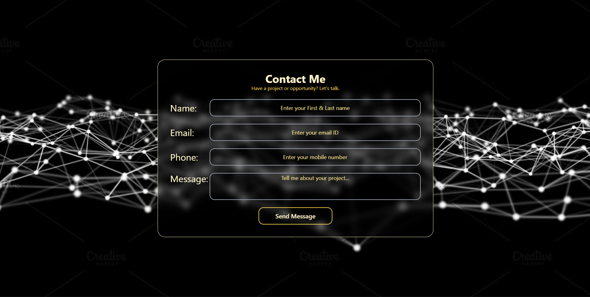
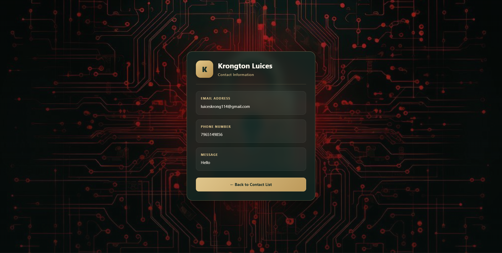

# 📇 Contact Management

### One Place. Every Connection.

A responsive contact management application built with React.js — designed to add, organize, and view contact information through a clean and interactive interface.

[🌐 Live Demo](https://pranab0104.github.io/contact-management/) · [💻 GitHub Repository](https://github.com/Pranab0104/contact-management)

---

## 🌍 Overview

Contact Management is a web application developed to practice building interactive, component-based user interfaces using React.js.

The application allows users to enter contact information through a form and navigate between different pages to view saved contacts.

Built with React, React Router, Tailwind CSS, and SCSS, the project focuses on form handling, state management, reusable components, and client-side navigation.

---

## ✨ Features

- 📝 Add contacts through an interactive form
- 👤 Collect and manage contact information
- 📋 View saved contacts on a dedicated page
- 🔗 Navigate between pages using React Router
- ⚛️ Component-based React architecture
- 🎨 Styled using Tailwind CSS and SCSS
- 📱 Responsive user interface
- 🚀 Deployed using GitHub Pages

---

## 📸 Screenshots

### Contact Form



### Contact List


### Contact Details



---

## 🛠️ Tech Stack

- React.js
- JavaScript
- React Router DOM
- Tailwind CSS
- SCSS
- Vite
- GitHub Pages

---

## 📂 Project Structure

```text
contact-management/
├── public/
├── screenshots/
├── src/
│   ├── pages/
│   ├── App.jsx
│   ├── main.jsx
│   ├── index.css
│   └── style.scss
├── index.html
├── package.json
├── vite.config.js
└── README.md
```

---

## ⚙️ Installation & Setup

Clone the repository:

```bash
git clone https://github.com/Pranab0104/contact-management.git
```

Navigate into the project:

```bash
cd contact-management
```

Install dependencies:

```bash
npm install
```

Start the development server:

```bash
npm run dev
```

Open the local URL displayed in your terminal to explore the application.

---

## 📱 Responsive Design

The application is designed to provide a user-friendly experience across different screen sizes:

- Desktop
- Laptop
- Tablet
- Mobile

---

## 🚀 Future Improvements

- ✏️ Edit existing contacts
- 🗑️ Delete contacts
- 🔍 Search and filter contacts
- 💾 Persist contact data using Local Storage
- 👤 Display detailed information for individual contacts
- ✅ Improve form validation and error handling
- ✨ Enhance animations and user interactions

---

## 👨‍💻 Author

**Pranav Mandal**

Frontend Developer

GitHub: [Pranab0104](https://github.com/Pranab0104)

---

⭐ If you find this project interesting, feel free to explore the repository!
